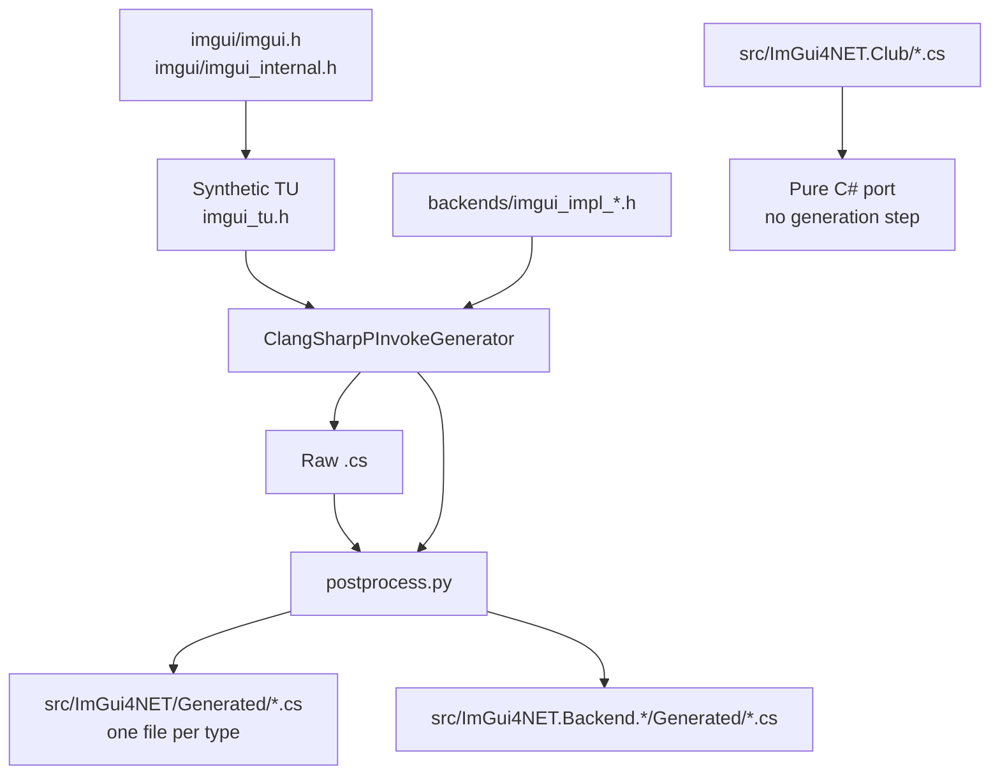

# Build Guide

**English** | [简体中文](build.zh-CN.md)

How to build ImGui4NET from source. The two stages are independent:
**generating bindings** (running ClangSharp) and **compiling native libraries**
(running the C++ compiler).

---

## Quick start

```bash
# 1. Fetch submodules (imgui + imgui_club)
git submodule update --init --recursive

# 2. Restore the pinned dotnet tools (ClangSharpPInvokeGenerator)
dotnet tool restore

# 3. Download the NuGet-hosted native dependencies (Allegro / freeglut)
./tools/fetch-deps.sh

# 4. Generate bindings and compile desktop native libraries
./tools/generate.sh --native

# 5. Build the managed assemblies
dotnet build ImGui4NET.slnx
```

Only want the NuGet packages:

```bash
dotnet pack ImGui4NET.slnx -c Release -o ./artifacts
```

> `dotnet tool restore` must run before the first `generate.sh`. It reads
> `dotnet-tools.json` and installs `ClangSharpPInvokeGenerator` at the pinned
> version, so generated code stays reproducible across machines. Skipping it
> produces `error: dotnet tool 'ClangSharpPInvokeGenerator' not found`.

---

## Prerequisites

| Tool | Purpose | Version |
|---|---|---|
| .NET SDK | Build managed code, run ClangSharp | 10.0+ |
| bash | Run `tools/*.sh` | 4.0+ |
| python3 | Post-process generated output | 3.9+ |
| C++17 compiler | Compile native libraries | g++ / clang++ / MSVC's clang |
| git | Submodules | any |

`tools/generate.sh` probes `g++` → `clang++` → `c++` on its own. Override with
the `CXX` environment variable.

### Platform notes

| Platform | Compiler | Notes |
|---|---|---|
| Windows | MSYS2 MinGW64 g++ | Typically `D:/Softwares/msys2/mingw64` |
| Linux | system g++ | Needs `build-essential libgl1-mesa-dev libglfw3-dev libsdl2-dev libvulkan-dev freeglut3-dev liballegro5-dev` |
| Android | NDK clang | See the dedicated section below |
| macOS | clang + `ld64.lld` | Cross-builds from any host; see [macOS](#macos) |

ClangSharp needs a clang resource directory. The script searches
`MINGW_ROOT/lib/clang/*`, `/usr/lib/clang`, `/usr/lib/llvm-*/lib/clang`. You can
also set it explicitly:

```bash
export CLANG_RESOURCE=/path/to/clang/22
```

---

## `generate.sh` usage

```bash
./tools/generate.sh                          # generate bindings only
./tools/generate.sh --native                 # generate + build desktop natives
./tools/generate.sh --android                # generate + build Android arm64 natives
./tools/generate.sh --macos                  # generate + build macOS natives
./tools/generate.sh --all                    # generate + desktop + Android + macOS
./tools/generate.sh --native --no-generate   # build natives only, keep bindings
./tools/generate.sh --help
```

### When `--no-generate` is mandatory

The bindings are generated with a **Windows target triple**
(`x86_64-w64-windows-gnu`), so every `DllImport` name is **LLP64-mangled**:

```
_ZN5ImGui8MemAllocEy        ← y = unsigned long long (Windows size_t)
```

Running the full `generate.sh` on Linux regenerates everything with
`x86_64-unknown-linux-gnu`, which mangles `size_t` as `m`. That silently breaks
the Windows package, whose `EntryPoint` strings no longer resolve.

So when cross-building:

```bash
# Generate once on Windows and commit the result
./tools/generate.sh

# On Linux / Android only rebuild the native libraries
./tools/generate.sh --native --no-generate
./tools/generate.sh --android --no-generate
```

The LP64 spelling differences are patched at link time by
`tools/lp64-aliases.py` using `--defsym`; see [Symbol aliases](#symbol-aliases).

### Environment variables

| Variable | Default | Purpose |
|---|---|---|
| `CXX` | auto-detected | C++ compiler |
| `PYTHON` | `python3` | Interpreter for the post-processing script |
| `MINGW_ROOT` | — | Helps locate the clang resource directory |
| `CLANG_RESOURCE` | auto-detected | clang resource directory |
| `ANDROID_NDK` | auto-detected | NDK root |
| `ANDROID_API` | `24` | Android API level |
| `TOOLCHAIN_PREFIX` | derived from `CXX` | Locates nested headers such as SDL2 |
| `MACOS_SDK_DIR` | `third_party/macos-sdk/<version>/MacOSX<version>.sdk` | macOS SDK to build against |
| `MACOS_SDK_VERSION` | `26.0` | SDK version downloaded when `MACOS_SDK_DIR` is unset |
| `MACOS_MIN_VERSION` | `11.0` | `-mmacosx-version-min` / `-platform_version` |
| `MACOS_ARCHES` | `x64 arm64` | Architectures to build |
| `MACOS_CXX` | auto-detected clang | Compiler used for macOS objects |
| `MACOS_LD` | auto-detected `ld64.lld` | Mach-O linker |

---

## What the generation pipeline does



### Why a synthetic translation unit

Generating from `imgui.cpp` drops every function that has a body
(`--generate funcs-with-body=false`). Generating from `imgui.h` alone misses the
full definitions of internal structs such as `ImGuiContext` and `ImGuiWindow`.

A synthetic header that includes both is the only way to get everything in one
pass:

```c
// imgui_tu.h
#include "imgui.h"
#include "imgui_internal.h"
```

### `-t` versus `-f`

| Flag | Meaning |
|---|---|
| `-f` | Parse entry point (translation unit) |
| `-t` | Header allowed to **emit** output |

This is why `imgui.h` is deliberately **not** listed under `-t` for a backend:

```bash
# imgui.h is parsed as a dependency but not listed under -t
-t "backends/imgui_impl_glfw.h"
```

Adding `imgui.h` to `-t` duplicates every Dear ImGui type into the consumer
package and collides with the core assembly (measured in the club package: 266
lines grew to 5112). `ImGui4NET.Club` needs no generation step at all any more,
since it is a pure C# port.

### Main postprocess.py rewrites

ClangSharp emits "C++-shaped C#", which needs fixing before it compiles:

| Rewrite | Input | Output |
|---|---|---|
| Template expansion | `ImVector<T>` / `ImBitArray` / `ImSpan` / `ImPool` / `ImChunkStream` / `ImStableVector` / `ImSmallStack` | Equivalent fixed-layout fields |
| Trailing underscore | `ImDrawFlags_` | `ImDrawFlags` |
| String parameters | `sbyte* label` | `string label` (`LPUTF8Str`) |
| String defaults | `= "%.3f"u8` | `= null` |
| Bool defaults | `byte x = false` | `byte x = 0` |
| Negative masks | `~0x7FFFFFF0` | `-2147483633` |
| File pointer | `_iobuf*` | `void*` |
| Struct safety | `partial struct` | `unsafe partial struct` |
| Constructors | `Foo(Foo* pThis)` | `Foo_Ctor(...)` |
| Type prefixes | `ImGui_ImplDX11_RenderState` | `RenderState` |
| Method prefixes | `ImGui_ImplOpenGL3_Init` | `Init` |
| Splitting | Single file | One file per type |

> The trailing-underscore rewrite must **protect `EntryPoint = "..."` strings
> first**. Mangled symbols can legitimately end with `_`
> (`_Z10ImFileOpenPKcS0_`), and trimming it yields a runtime
> `EntryPointNotFoundException`.

---

## Native library builds

### Desktop

```bash
./tools/generate.sh --native
```

Output locations:

```
src/ImGui4NET/runtimes/<rid>/native/imgui.dll | libimgui.so
src/ImGui4NET.Backend.*/runtimes/<rid>/native/imgui_backend_*.dll | lib*.so
```

Link libraries per platform:

| Backend | Windows | Linux |
|---|---|---|
| OpenGL2 / OpenGL3 | `-lopengl32` | `-lGL` |
| Glfw | `-lglfw3 -lopengl32 -lgdi32` | `-lglfw -lGL` |
| Glut | `-lopengl32 -lfreeglut` | `-lGL -lglut` |
| Sdl2 | `-lSDL2` | `-lSDL2` |
| Sdl3 / SdlGpu3 | `-lSDL3` | `-lSDL3` |
| Vulkan | `-lvulkan-1` | `-lvulkan` |
| DirectX9/11/12 | `-ld3d9` / `-ld3d11 -ldxgi` / `-ld3d12 -ldxgi` + `-ld3dcompiler` | — |
| Win32 | `-ldwmapi -lgdi32 -limm32 -lole32` | — |

### Android

```bash
export ANDROID_NDK=/d/AndroidSDK/android-ndk-r27c
./tools/generate.sh --android
```

The script locates `aarch64-linux-android${ANDROID_API}-clang++` and prefers the
extension-less binary: MSYS2 ships both, and only the extension-less one is
directly executable from bash.

**The API level must be 24 or higher**, because `libvulkan.so` first appears at
24. Lower values fail to link the Vulkan backend.

Backends available on Android:

| Backend | Available | Reason |
|---|:---:|---|
| OpenGL3 | ✅ | Links `-lGLESv2 -lEGL` |
| Vulkan | ✅ | `-lvulkan` |
| Android | ✅ | `-landroid -llog` |
| OpenGL2 | ❌ | Fixed-function pipeline needs `GL/gl.h`; NDK only ships GLES |
| Glfw / Sdl2 / Sdl3 / Glut / Allegro5 | ❌ | No NDK headers |

### macOS

```bash
./tools/generate.sh --macos --no-generate
```

Builds `libimgui.dylib` for `osx-x64` and `osx-arm64`, plus the OpenGL2,
OpenGL3 and Glut backends. It runs on Windows or Linux — no Mac required.

**The SDK is the one unusual requirement.** Linking a Mach-O needs Apple's
system headers, the libc++ headers and the `.tbd` stubs that stand in for the
real shared libraries. None of those come with a normal host toolchain, so
`tools/fetch-macos-sdk.sh` downloads the republished SDK tarball on first use:

```bash
./tools/fetch-macos-sdk.sh              # into third_party/macos-sdk/26.0/
./tools/fetch-macos-sdk.sh /opt/sdk     # or somewhere else
```

`generate.sh --macos` calls it automatically when `MACOS_SDK_DIR` does not
exist. The SDK is ~1.4 GB unpacked and git-ignored.

Backends available on macOS:

| Backend | Available | Reason |
|---|:---:|---|
| OpenGL2 / OpenGL3 | ✅ | `-framework OpenGL` |
| Glut | ✅ | `-framework OpenGL -framework GLUT -framework Cocoa` |
| Glfw / Sdl2 / Sdl3 / Vulkan | ❌ | Headers are not part of the SDK; vendoring them is not done yet |
| Metal | ✅ | `-framework Metal -framework MetalKit -framework Cocoa -framework QuartzCore` |
| Metal4 | ✅ arm64 only | `-framework Metal -framework QuartzCore -framework Cocoa`; requires macOS 26 and Apple Silicon |
| OSX | ✅ | `-framework Cocoa -framework GameController -framework Metal -framework QuartzCore` |

Three macOS specifics the script handles:

- **`@loader_path` install names.** A backend records its dependency on the core
  library as `@loader_path/libimgui.dylib`, so the pair resolves from the same
  `runtimes/<rid>/native` folder no matter where the package is unpacked.
- **LP64 aliases via assembly.** `ld64.lld -alias` cannot bind to a symbol
  defined by an object file, so `lp64-aliases.py --format asm` emits a `.s` file
  that the assembler turns into real aliases. x64 needs 46, arm64 needs 29 —
  `va_list` already differs between the two (`P13__va_list_tag` vs `Pc`).
- **Deployment target.** `-mmacosx-version-min` beside `-platform_version`;
  `MACOSX_DEPLOYMENT_TARGET` does not reach a direct `ld64.lld` invocation.

#### SDK version vs. deployment target

These are two independent things, and only the first decides whether a library
loads on an older macOS:

| Field | Where it comes from | Meaning at run time |
|---|---|---|
| `minos` | `-mmacosx-version-min` / `-platform_version` | **Minimum OS the dylib loads on** |
| `sdk` | The SDK tarball used to compile | Recorded only; never consulted |

So an SDK 26 build with `MACOS_MIN_VERSION=11.0` produces `minos=11.0`,
`sdk=26.0`, and loads on macOS 11. Verified on the shipped libraries:

```bash
# What the linker recorded
python - <<'PY'
import struct
from pathlib import Path
d = Path("src/ImGui4NET/runtimes/osx-arm64/native/libimgui.dylib").read_bytes()
ncmds = struct.unpack_from("<I", d, 16)[0]
off = 32
for _ in range(ncmds):
    cmd, size = struct.unpack_from("<II", d, off)
    if (cmd & 0x7fffffff) == 0x32:          # LC_BUILD_VERSION
        _, minos, sdk, _ = struct.unpack_from("<IIII", d, off + 8)
        f = lambda v: f"{v >> 16}.{(v >> 8) & 0xff}"
        print(f"minos={f(minos)} sdk={f(sdk)}")
    off += size
PY
```

Two further checks back this up, both reproducible:

- **Imports are identical.** A core dylib built from SDK 14.5 and from SDK 26.0
  has the same 59 undefined symbols (`_malloc`, `_snprintf`, `_sinf`, …). No
  new API from a newer macOS leaks in, because Dear ImGui only uses libc and
  libc++.
- **No weak imports.** A binary that opportunistically used newer APIs would
  carry `N_WEAK_DEF` undefined symbols, which dyld tolerates. These libraries
  have zero.

Where it does bite: **an SDK 26 header that marks a symbol macOS 26-only**. Those
become hard dependencies the moment the code calls them, and the compiler only
warns (`-Wunguarded-availability-new`). This is exactly why `Metal4` is the one
backend with a **per-backend deployment target**:

| Backend | `-mmacosx-version-min` | `minos` | Architectures |
|---|---|---|---|
| OpenGL2 / OpenGL3 / Glut / Metal / OSX | `MACOS_MIN_VERSION` (11.0) | 11.0 | x64 + arm64 |
| Metal4 | `26.0` | **26.0** | **arm64 only** |

`imgui_impl_metal4.mm` binds `MTL4RenderPassDescriptor` and `MTL4CommandQueue`,
both `API_AVAILABLE(macos(26.0))`, with no runtime guard in the source. Compiling
it with an 11.0 floor merely silences the availability warnings — the resulting
dylib would still be accepted by dyld on macOS 11 and then fail on the first
symbol lookup. Recording `minos=26.0` turns that into an honest load-time
rejection. It is also arm64-only, because Metal 4 requires Apple Silicon.

Both constraints live in the `OBJC_BACKENDS` table in `generate.sh`:

```bash
# name|header|frameworks|opaque types|deployment target|architectures
"Metal4|imgui_impl_metal4.h|-framework Metal ...|MTL4RenderPassDescriptor ...|26.0|arm64"
```

Verified on the shipped library:

```
LC_BUILD_VERSION platform=1 minos=26.0.0 sdk=26.0.0
```

`ld64.lld` ships in the MSYS2 clang package:

```bash
pacman -S mingw-w64-x86_64-lld
```

### Objective-C++ backends (Metal, Metal4, OSX)

`Metal`, `Metal4` and `OSX` are the only backends written in Objective-C++, and
that changes three things:

- **Generation.** Their headers declare the API only inside `#ifdef __OBJC__`,
  so the generator is invoked with `-x objective-c++`
  (`tools/gen-objc-backend.sh`, called from `generate.sh`).
- **Handle types.** Objective-C classes and protocols (`id<MTLDevice>`,
  `MTL4CommandBuffer`, `NSView`) have no C# equivalent, and ClangSharp emits no
  declaration for a type it only sees forward-declared — it falls back to
  `void*`. `postprocess.py` therefore generates a `readonly struct` per handle
  into the backend's `Generated/` folder:

  ```csharp
  public readonly partial struct NSView
  {
      private readonly nint _h;
      public NSView(nint handle) => _h = handle;
      public nint Handle => _h;
      public bool IsNull => _h == 0;
      public static NSView Null => default;
  }
  ```

  The struct is a single machine word, so it is blittable and the extern takes it
  **by value** — the ABI passes the pointer the header declares, with no wrapper
  method and no marshalling:

  ```csharp
  [DllImport("imgui_backend_osx", EntryPoint = "_Z22ImGui_ImplOSX_NewFrameP6NSView")]
  public static extern void NewFrame([NativeTypeName("NSView * _Nullable")] NSView view);
  ```

  Nullability is carried in the `NativeTypeName` attribute for documentation;
  because the handle is a value type, a null one is `NSView.Null` (or `default`)
  rather than a nullable reference.
- **Symbol names.** Every C symbol in a Mach-O symbol table carries a leading
  underscore, and ClangSharp copies that spelling into `EntryPoint`. `dlsym()`
  wants the C name (`dlsym(3)` says the name "must NOT be prepended with an
  underscore"), so `postprocess.py --macho-symbols` strips it again. The `_Z…`
  body of the mangled name is untouched.

Method names drop the C prefix like every other backend: `ImGui_ImplMetal4_Init`
becomes `ImGui_ImplMetal4.Init`. A `bool` return stays a `byte`, matching the
other packages in this repository rather than wrapping it into a managed `bool`.

ClangSharp reports `Unsupported declaration: 'ObjCInterface'` / `'ObjCProtocol'`
for those forward declarations and exits non-zero. That is expected: the script
treats an empty output file as the failure condition, not the exit code.

CI does not build any of these libraries. Like the other RIDs, the `.dylib` files
are committed under `src/**/runtimes/osx-*/native/`.

### imgui_club: pure C# port

`ImGui4NET.Club` ships **no native library**. The three club extensions are
ported to plain C# instead of bound through P/Invoke, because every one of their
methods is **defined inside its class body**:

```cpp
struct MemoryEditor {
    void DrawWindow(const char* title, void* mem_data, ...) { ... }  // inline in class
};
```

That causes two problems:

1. **ClangSharp emits no extern** — `funcs-with-body=false` skips functions with bodies
2. **The compiler emits no symbol** — an inline function only materialises in a TU that calls it

Forcing those bodies out of a native library (a `-fkeep-inline-functions`
compilation unit plus `-O0`, and `-femit-all-decls` on Clang) works, but it is a
lot of machinery to bind code that only ever calls the public Dear ImGui API.
The port was therefore simpler than the binding:

| Extension | Port |
|---|---|
| `imgui_memory_editor.h` | [`MemoryEditor.cs`](../src/ImGui4NET.Club/MemoryEditor.cs) — `MemoryEditor` |
| `imgui_multicontext_compositor.h` | [`ImGuiMultiContextCompositor.cs`](../src/ImGui4NET.Club/ImGuiMultiContextCompositor.cs) — `MultiContextCompositor` |
| `imgui_threaded_rendering.h` | [`ImDrawDataSnapshot.cs`](../src/ImGui4NET.Club/ImDrawDataSnapshot.cs) and [`ImTextureQueue.cs`](../src/ImGui4NET.Club/ImTextureQueue.cs) |

Two points about the ports are not obvious:

- **`ImVector` mutations must use `ImGui.MemAlloc`/`MemFree`.** A draw list whose
  `CmdBuffer` was allocated by the CLR cannot be handed back to Dear ImGui, so
  [`ImVectorUtil.cs`](../src/ImGui4NET.Club/ImVectorUtil.cs) reproduces
  `reserve`/`resize`/`push_back`/`swap`/`clear` against Dear ImGui's allocator.
- **`ImTextureQueue`'s per-texture records live in native memory.** Their address
  is stored in `ImTextureData.QueueUserData` and dereferenced by the render
  thread, so a managed object would move.

`generate.sh` prints `imgui_club: pure C# port, nothing to generate` and does
nothing for this package: there is no SDK step, no native build, and no RID
folder.

---

## Symbol aliases

The bindings are LLP64-generated. LP64 platforms differ in three places:

| Type | Windows (LLP64) | x86_64 Linux | aarch64 Android | macOS x64 | macOS arm64 |
|---|---|---|---|---|---|
| `size_t` | `y` | `m` | `m` | `m` | `m` |
| `FILE` | `_iobuf` | `_IO_FILE` | `__sFILE` | `__sFILE` | `__sFILE` |
| `va_list` | `Pc` / `S_` | `P13__va_list_tag` | `St9__va_list` | `P13__va_list_tag` | `Pc` |

`tools/lp64-aliases.py` diffs the entry points the bindings expect against the
symbols the built library actually exports, then prints linker arguments:

```bash
-Wl,--defsym=_ZN5ImGui8MemAllocEy=_ZN5ImGui8MemAllocEm
```

Mach-O has no linker switch that can alias a symbol defined by an object file,
so `--format asm` emits an assembly file instead:

```asm
    .globl __ZN5ImGui8MemAllocEy
    .set __ZN5ImGui8MemAllocEy, __ZN5ImGui8MemAllocEm
```

One binding set therefore serves all platforms.

The script applies to the core library and every native backend library. It
**iterates to a fixed point**, since each relink can expose more mappable symbols:

```bash
for attempt in 1 2 3 4; do
    link → recompute aliases → exit when the count stops growing
done
```

---

## Output layout

```
build/                          # not committed, excluded via .gitignore
  implib/<rid>/libimgui.dll.a   # MinGW link-time only, never packed
  logs/<name>.log               # compiler logs; check these on failure
  macos-obj/<arch>/*.o          # macOS objects and the generated alias .s

src/ImGui4NET/
  Generated/                    # 212 files, one type per file
  runtimes/<rid>/native/        # native libraries
  ImVector.cs                   # hand-written: C++ templates cannot be generated
  NativeTypeNameAttribute.cs    # hand-written: must be public to be shared

src/ImGui4NET.Club/
  MemoryEditor.cs               # hand-written: pure C# port
  ImGuiMultiContextCompositor.cs
  ImDrawDataSnapshot.cs
  ImTextureQueue.cs
  ImVectorUtil.cs               # hand-written: ImVector ops on ImGui's allocator

src/ImGui4NET.Backend.*/
  Generated/                    # a few files per backend
  runtimes/<rid>/native/        # that backend's native library
```

---

## Troubleshooting

### `error: no clang resource directory found`

ClangSharp needs clang's built-in headers. Point it at them:

```bash
export CLANG_RESOURCE=D:/Softwares/msys2/mingw64/lib/clang/22
```

### `$'\r': command not found` when running generate.sh on Linux

The scripts have CRLF line endings. The repo ships a `.gitattributes` forcing
`*.sh eol=lf`; if it is still broken:

```bash
sed -i 's/\r$//' tools/*.sh
```

### `EntryPointNotFoundException` on Linux or Android

The aliases did not apply. Check:

```bash
nm -D --defined-only src/ImGui4NET/runtimes/linux-x64/native/libimgui.so | grep _ZN5ImGui8MemAllocEy
```

Both `...Ey` and `...Em` should be present.

### Android: `undefined symbol: ImGuiClub_ForceInstantiation`

This placeholder no longer exists: `imgui_club` is a pure C# port and builds no
native library on any platform. If an old build output still references
`libimgui_club.so` or `imgui_club.dll`, delete the stale `runtimes/` folder
under `src/ImGui4NET.Club/`.

### `error: dotnet tool 'ClangSharpPInvokeGenerator' not found`

Run `dotnet tool restore` from the repository root.

### `rdynamic` warnings

Linux and Android require `-Wl,--export-dynamic` (already supplied by the
script); otherwise the dynamic symbol table is incomplete.

---

## Verifying a build

```bash
# Managed layer (net10.0; Windows backends also build net10.0-windows)
dotnet build ImGui4NET.slnx

# Runtime smoke test
dotnet run --project samples/ImGui4NET.Sample.OpenGL3
```

The sample also drives the `imgui_club` Memory Editor through its pure C# port,
so it exercises `ImGui4NET.Club` (`MemoryEditor`, no native library) at the
same time.

Quick check of exported symbol counts:

```bash
# Windows
objdump -p src/ImGui4NET/runtimes/win-x64/native/imgui.dll | grep -c '_Z'
# Linux / Android
nm -D --defined-only src/ImGui4NET/runtimes/linux-x64/native/libimgui.so | grep -c '_Z'
```

Expected: roughly 1200+ for the core library.

---

## Publishing to NuGet

Publishing runs in CI (`.github/workflows/publish.yml`) on a `v*` tag, using
[NuGet Trusted Publishing](https://learn.microsoft.com/nuget/nuget-org/trusted-publishing):
the workflow exchanges a GitHub OIDC token for a temporary API key, so no
long-lived secret is stored in the repository.

One-time setup on nuget.org:

1. Account → **Trusted Publishing** → add a policy.
2. Repository Owner `StArraySharp`, Repository `ImGui4NET`, Workflow File
   `publish.yml`, Environment `release`.
3. Add a repository secret `NUGET_USER` holding your nuget.org **profile name**
   (not the email address).
4. Request prefix reservation for `ImGui4NET` so nobody else can publish under
   `ImGui4NET.*`.

Releasing a version:

```bash
# 1. Bump LibraryRevision in src/Directory.Build.props if only bindings changed,
#    or ImGuiVersion when moving to a new Dear ImGui tag.
# 2. Update docs/CHANGELOG.md.
# 3. Tag and push; the workflow packs and publishes.
git commit -am "release: 1.93.0.2"
git tag v1.93.0.2
git push origin main --tags
```

The workflow refuses to publish when a package version differs from the tag.

Local dry run:

```bash
dotnet pack ImGui4NET.slnx -c Release -o ./artifacts
# inspect the contents before pushing
unzip -l artifacts/ImGui4NET.1.93.0.1.nupkg
```