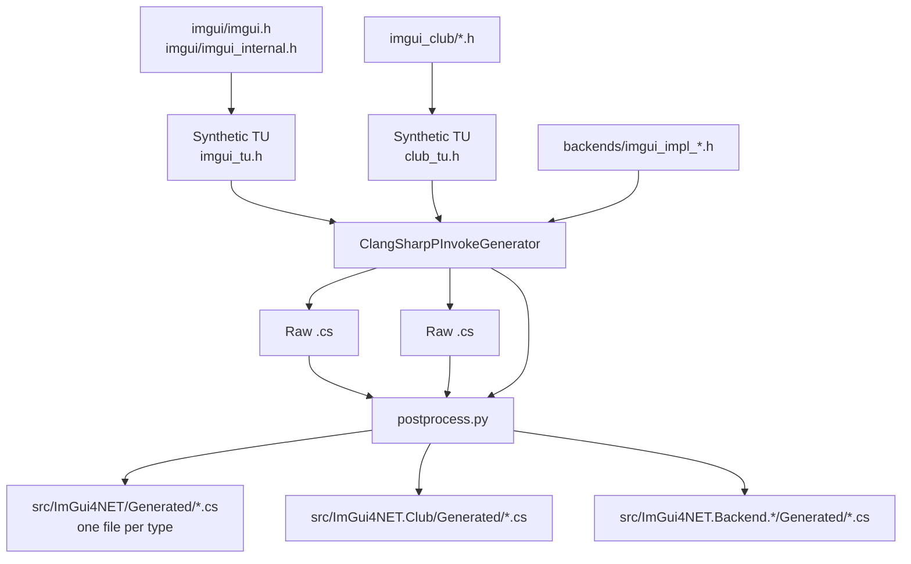

# Build Guide

**English** | [简体中文](build.zh-CN.md)

How to build ImGui4NET from source. The two stages are independent:
**generating bindings** (running ClangSharp) and **compiling native libraries**
(running the C++ compiler).

---

## Quick start

```bash
# 1. Fetch submodules (imgui + imgui_club)
git submodule update --init --recursive

# 2. Restore the pinned dotnet tools (ClangSharpPInvokeGenerator)
dotnet tool restore

# 3. Download the NuGet-hosted native dependencies (Allegro / freeglut)
./tools/fetch-deps.sh

# 4. Generate bindings and compile desktop native libraries
./tools/generate.sh --native

# 5. Build the managed assemblies
dotnet build ImGui4NET.slnx
```

Only want the NuGet packages:

```bash
dotnet pack ImGui4NET.slnx -c Release -o ./artifacts
```

> `dotnet tool restore` must run before the first `generate.sh`. It reads
> `dotnet-tools.json` and installs `ClangSharpPInvokeGenerator` at the pinned
> version, so generated code stays reproducible across machines. Skipping it
> produces `error: dotnet tool 'ClangSharpPInvokeGenerator' not found`.

---

## Prerequisites

| Tool | Purpose | Version |
|---|---|---|
| .NET SDK | Build managed code, run ClangSharp | 10.0+ |
| bash | Run `tools/*.sh` | 4.0+ |
| python3 | Post-process generated output | 3.9+ |
| C++17 compiler | Compile native libraries | g++ / clang++ / MSVC's clang |
| git | Submodules | any |

`tools/generate.sh` probes `g++` → `clang++` → `c++` on its own. Override with
the `CXX` environment variable.

### Platform notes

| Platform | Compiler | Notes |
|---|---|---|
| Windows | MSYS2 MinGW64 g++ | Typically `D:/Softwares/msys2/mingw64` |
| Linux | system g++ | Needs `build-essential libgl1-mesa-dev libglfw3-dev libsdl2-dev libvulkan-dev freeglut3-dev liballegro5-dev` |
| Android | NDK clang | See the dedicated section below |

ClangSharp needs a clang resource directory. The script searches
`MINGW_ROOT/lib/clang/*`, `/usr/lib/clang`, `/usr/lib/llvm-*/lib/clang`. You can
also set it explicitly:

```bash
export CLANG_RESOURCE=/path/to/clang/22
```

---

## `generate.sh` usage

```bash
./tools/generate.sh                          # generate bindings only
./tools/generate.sh --native                 # generate + build desktop natives
./tools/generate.sh --android                # generate + build Android arm64 natives
./tools/generate.sh --all                    # generate + desktop + Android
./tools/generate.sh --native --no-generate   # build natives only, keep bindings
./tools/generate.sh --help
```

### When `--no-generate` is mandatory

The bindings are generated with a **Windows target triple**
(`x86_64-w64-windows-gnu`), so every `DllImport` name is **LLP64-mangled**:

```
_ZN5ImGui8MemAllocEy        ← y = unsigned long long (Windows size_t)
```

Running the full `generate.sh` on Linux regenerates everything with
`x86_64-unknown-linux-gnu`, which mangles `size_t` as `m`. That silently breaks
the Windows package, whose `EntryPoint` strings no longer resolve.

So when cross-building:

```bash
# Generate once on Windows and commit the result
./tools/generate.sh

# On Linux / Android only rebuild the native libraries
./tools/generate.sh --native --no-generate
./tools/generate.sh --android --no-generate
```

The LP64 spelling differences are patched at link time by
`tools/lp64-aliases.py` using `--defsym`; see [Symbol aliases](#symbol-aliases).

### Environment variables

| Variable | Default | Purpose |
|---|---|---|
| `CXX` | auto-detected | C++ compiler |
| `PYTHON` | `python3` | Interpreter for the post-processing script |
| `MINGW_ROOT` | — | Helps locate the clang resource directory |
| `CLANG_RESOURCE` | auto-detected | clang resource directory |
| `ANDROID_NDK` | auto-detected | NDK root |
| `ANDROID_API` | `24` | Android API level |
| `TOOLCHAIN_PREFIX` | derived from `CXX` | Locates nested headers such as SDL2 |

---

## What the generation pipeline does



### Why a synthetic translation unit

Generating from `imgui.cpp` drops every function that has a body
(`--generate funcs-with-body=false`). Generating from `imgui.h` alone misses the
full definitions of internal structs such as `ImGuiContext` and `ImGuiWindow`.

A synthetic header that includes both is the only way to get everything in one
pass:

```c
// imgui_tu.h
#include "imgui.h"
#include "imgui_internal.h"
```

### `-t` versus `-f`

| Flag | Meaning |
|---|---|
| `-f` | Parse entry point (translation unit) |
| `-t` | Header allowed to **emit** output |

This is why the club package stays small:

```bash
# imgui.h is parsed as a dependency but not listed under -t
-t "$CLUB_TU" \
-t "imgui_club/imgui_memory_editor/imgui_memory_editor.h" \
...
```

Adding `imgui.h` to `-t` duplicates every Dear ImGui type into the club package
and collides with the core assembly (measured: 266 lines grew to 5112).

### Main postprocess.py rewrites

ClangSharp emits "C++-shaped C#", which needs fixing before it compiles:

| Rewrite | Input | Output |
|---|---|---|
| Template expansion | `ImVector<T>` / `ImBitArray` / `ImSpan` / `ImPool` / `ImChunkStream` / `ImStableVector` / `ImSmallStack` | Equivalent fixed-layout fields |
| Trailing underscore | `ImDrawFlags_` | `ImDrawFlags` |
| String parameters | `sbyte* label` | `string label` (`LPUTF8Str`) |
| String defaults | `= "%.3f"u8` | `= null` |
| Bool defaults | `byte x = false` | `byte x = 0` |
| Negative masks | `~0x7FFFFFF0` | `-2147483633` |
| File pointer | `_iobuf*` | `void*` |
| Struct safety | `partial struct` | `unsafe partial struct` |
| Constructors | `Foo(Foo* pThis)` | `Foo_Ctor(...)` |
| Type prefixes | `ImGui_ImplDX11_RenderState` | `RenderState` |
| Method prefixes | `ImGui_ImplOpenGL3_Init` | `Init` |
| Splitting | Single file | One file per type |

> The trailing-underscore rewrite must **protect `EntryPoint = "..."` strings
> first**. Mangled symbols can legitimately end with `_`
> (`_Z10ImFileOpenPKcS0_`), and trimming it yields a runtime
> `EntryPointNotFoundException`.

---

## Native library builds

### Desktop

```bash
./tools/generate.sh --native
```

Output locations:

```
src/ImGui4NET/runtimes/<rid>/native/imgui.dll | libimgui.so
src/ImGui4NET.Backend.*/runtimes/<rid>/native/imgui_backend_*.dll | lib*.so
src/ImGui4NET.Club/runtimes/<rid>/native/imgui_club.*
```

Link libraries per platform:

| Backend | Windows | Linux |
|---|---|---|
| OpenGL2 / OpenGL3 | `-lopengl32` | `-lGL` |
| Glfw | `-lglfw3 -lopengl32 -lgdi32` | `-lglfw -lGL` |
| Glut | `-lopengl32 -lfreeglut` | `-lGL -lglut` |
| Sdl2 | `-lSDL2` | `-lSDL2` |
| Sdl3 / SdlGpu3 | `-lSDL3` | `-lSDL3` |
| Vulkan | `-lvulkan-1` | `-lvulkan` |
| DirectX9/11/12 | `-ld3d9` / `-ld3d11 -ldxgi` / `-ld3d12 -ldxgi` + `-ld3dcompiler` | — |
| Win32 | `-ldwmapi -lgdi32 -limm32 -lole32` | — |

### Android

```bash
export ANDROID_NDK=/d/AndroidSDK/android-ndk-r27c
./tools/generate.sh --android
```

The script locates `aarch64-linux-android${ANDROID_API}-clang++` and prefers the
extension-less binary: MSYS2 ships both, and only the extension-less one is
directly executable from bash.

**The API level must be 24 or higher**, because `libvulkan.so` first appears at
24. Lower values fail to link the Vulkan backend.

Backends available on Android:

| Backend | Available | Reason |
|---|:---:|---|
| OpenGL3 | ✅ | Links `-lGLESv2 -lEGL` |
| Vulkan | ✅ | `-lvulkan` |
| Null | ✅ | No dependencies |
| Android | ✅ | `-landroid -llog` |
| OpenGL2 | ❌ | Fixed-function pipeline needs `GL/gl.h`; NDK only ships GLES |
| Glfw / Sdl2 / Sdl3 / Glut / Allegro5 | ❌ | No NDK headers |

### imgui_club caveat

Every club method is **defined inside its class body**:

```cpp
struct MemoryEditor {
    void DrawWindow(const char* title, void* mem_data, ...) { ... }  // inline in class
};
```

That causes two problems:

1. **ClangSharp emits no extern** — `funcs-with-body=false` skips functions with bodies
2. **The compiler emits no symbol** — an inline function only materialises in a TU that calls it

The solution has two layers:

**Generation:** take only the struct layout (`Generated/MemoryEditor.cs` etc.).
The externs live in hand-written `ClubNative.cs`.

**Build:** `tools/club-instantiate.cpp` actually constructs each object and calls
each method, combined with a compiler flag:

| Compiler | Flag | Notes |
|---|---|---|
| GCC | `-fkeep-inline-functions` | Emits inline definitions |
| Clang | `-femit-all-decls` + `-O0` | **`-fkeep-inline-functions` is not supported** |

`-O0` is essential on Clang: at `-O2` it inlines or discards the instantiation
calls, so the constructors are never emitted.

Android additionally needs `-fvisibility=default -Wl,--export-dynamic`. Without
them the symbols exist only in the symbol table, not the dynamic table, and the
CLR cannot resolve them.

---

## Symbol aliases

The bindings are LLP64-generated. LP64 platforms differ in three places:

| Type | Windows (LLP64) | x86_64 Linux | aarch64 Android |
|---|---|---|---|
| `size_t` | `y` | `m` | `m` |
| `FILE` | `_iobuf` | `_IO_FILE` | `__sFILE` |
| `va_list` | `Pc` / `S_` | `P13__va_list_tag` | `St9__va_list` |

`tools/lp64-aliases.py` diffs the entry points the bindings expect against the
symbols the built library actually exports, then prints linker arguments:

```bash
-Wl,--defsym=_ZN5ImGui8MemAllocEy=_ZN5ImGui8MemAllocEm
```

One binding set therefore serves all three platforms.

The script applies to both the core library and the club library, and it
**iterates to a fixed point**, since each relink can expose more mapable symbols:

```bash
for attempt in 1 2 3 4; do
    link → recompute aliases → exit when the count stops growing
done
```

---

## Output layout

```
build/                          # not committed, excluded via .gitignore
  implib/<rid>/libimgui.dll.a   # MinGW link-time only, never packed
  logs/<name>.log               # compiler logs; check these on failure

src/ImGui4NET/
  Generated/                    # 212 files, one type per file
  runtimes/<rid>/native/        # native libraries
  ImVector.cs                   # hand-written: C++ templates cannot be generated
  NativeTypeNameAttribute.cs    # hand-written: must be public to be shared

src/ImGui4NET.Club/
  Generated/                    # generated struct layouts
  ClubNative.cs                 # hand-written: externs for inline methods

src/ImGui4NET.Backend.*/
  Generated/                    # a few files per backend
  runtimes/<rid>/native/        # that backend's native library
```

---

## Troubleshooting

### `error: no clang resource directory found`

ClangSharp needs clang's built-in headers. Point it at them:

```bash
export CLANG_RESOURCE=D:/Softwares/msys2/mingw64/lib/clang/22
```

### `$'\r': command not found` when running generate.sh on Linux

The scripts have CRLF line endings. The repo ships a `.gitattributes` forcing
`*.sh eol=lf`; if it is still broken:

```bash
sed -i 's/\r$//' tools/*.sh
```

### `EntryPointNotFoundException` on Linux or Android

The aliases did not apply. Check:

```bash
nm -D --defined-only src/ImGui4NET/runtimes/linux-x64/native/libimgui.so | grep _ZN5ImGui8MemAllocEy
```

Both `...Ey` and `...Em` should be present.

### Android: `undefined symbol: ImGuiClub_ForceInstantiation`

`tools/club-instantiate.cpp` was not compiled in. Confirm the `club_src` array
includes it.

### `error: dotnet tool 'ClangSharpPInvokeGenerator' not found`

Run `dotnet tool restore` from the repository root.

### `rdynamic` warnings

Linux and Android require `-Wl,--export-dynamic` (already supplied by the
script); otherwise the dynamic symbol table is incomplete.

---

## Verifying a build

```bash
# Managed layer (builds net8.0 and net10.0)
dotnet build ImGui4NET.slnx

# Runtime smoke test
dotnet run --project samples/ImGui4NET.Sample.OpenGL3
```

The sample also drives the `imgui_club` Memory Editor, so it exercises
`ImGui4NET.Club` (struct layout, the hand-written `MemoryEditor_Ctor` and
`MemoryEditor_DrawWindow` entry points) at the same time.

Quick check of exported symbol counts:

```bash
# Windows
objdump -p src/ImGui4NET/runtimes/win-x64/native/imgui.dll | grep -c '_Z'
# Linux / Android
nm -D --defined-only src/ImGui4NET/runtimes/linux-x64/native/libimgui.so | grep -c '_Z'
```

Expected: roughly 1200+ for the core library and 24 for club (excluding extra
symbols produced by inline expansion).

---

## Publishing to NuGet

Publishing runs in CI (`.github/workflows/publish.yml`) on a `v*` tag, using
[NuGet Trusted Publishing](https://learn.microsoft.com/nuget/nuget-org/trusted-publishing):
the workflow exchanges a GitHub OIDC token for a temporary API key, so no
long-lived secret is stored in the repository.

One-time setup on nuget.org:

1. Account → **Trusted Publishing** → add a policy.
2. Repository Owner `StArraySharp`, Repository `ImGui4NET`, Workflow File
   `publish.yml`, Environment `release`.
3. Add a repository secret `NUGET_USER` holding your nuget.org **profile name**
   (not the email address).
4. Request prefix reservation for `ImGui4NET` so nobody else can publish under
   `ImGui4NET.*`.

Releasing a version:

```bash
# 1. Bump LibraryRevision in src/Directory.Build.props if only bindings changed,
#    or ImGuiVersion when moving to a new Dear ImGui tag.
# 2. Update docs/CHANGELOG.md.
# 3. Tag and push; the workflow packs and publishes.
git commit -am "release: 1.93.0.2"
git tag v1.93.0.2
git push origin main --tags
```

The workflow refuses to publish when a package version differs from the tag.

Local dry run:

```bash
dotnet pack ImGui4NET.slnx -c Release -o ./artifacts
# inspect the contents before pushing
unzip -l artifacts/ImGui4NET.1.93.0.1.nupkg
```