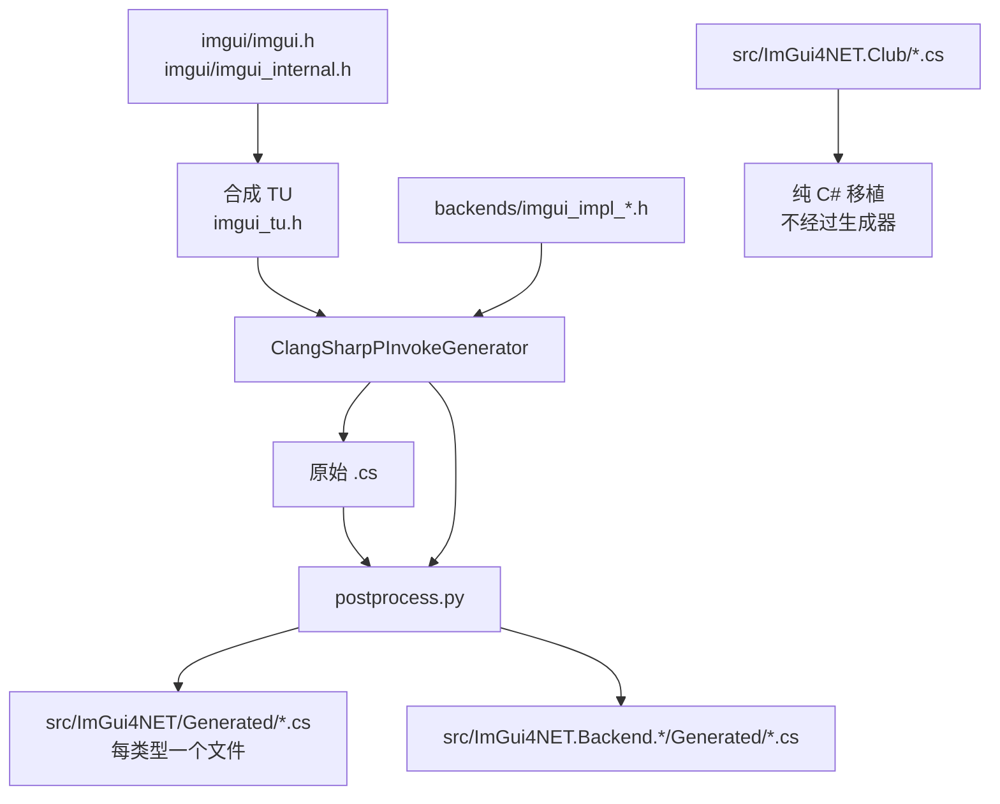

# 构建指南

[English](build.md) | **简体中文**

从源码构建 ImGui4NET 的完整流程。两个阶段互相独立：**生成绑定**（跑 ClangSharp）和**编译原生库**（跑 C++ 编译器）。

---

## 快速开始

```bash
# 1. 拉取子模块（imgui + imgui_club）
git submodule update --init --recursive

# 2. 还原 dotnet 工具（ClangSharpPInvokeGenerator）
dotnet tool restore

# 3. 下载 NuGet 形式的原生依赖（Allegro / freeglut）
./tools/fetch-deps.sh

# 4. 生成绑定 + 编译桌面原生库
./tools/generate.sh --native

# 5. 构建托管程序集
dotnet build ImGui4NET.slnx
```

只想要 NuGet 包：

```bash
dotnet pack ImGui4NET.slnx -c Release -o ./artifacts
```

> 首次运行 `generate.sh` 前必须先执行 `dotnet tool restore`。它会读取
> `dotnet-tools.json`，按锁定版本安装 `ClangSharpPInvokeGenerator`，保证不同机器上生成结果一致。

---

## 前置要求

| 工具 | 用途 | 版本 |
|---|---|---|
| .NET SDK | 编译托管代码、跑 ClangSharp | 10.0+ |
| bash | 执行 `tools/*.sh` | 4.0+ |
| python3 | 后处理生成结果 | 3.9+ |
| C++17 编译器 | 编译原生库 | g++ / clang++ / MSVC 的 clang |
| git | 子模块 | 任意 |

`tools/generate.sh` 会自己探测 `g++` → `clang++` → `c++`，也可以用 `CXX` 环境变量指定。

### 平台差异

| 平台 | 编译器 | 备注 |
|---|---|---|
| Windows | MSYS2 MinGW64 g++ | 路径通常为 `D:/Softwares/msys2/mingw64` |
| Linux | 系统 g++ | 需要 `build-essential libgl1-mesa-dev libglfw3-dev libsdl2-dev libvulkan-dev freeglut3-dev liballegro5-dev` |
| Android | NDK 里的 clang | 见下方专门章节 |
| macOS | clang + `ld64.lld` | 任意平台都能交叉编译，见 [macOS](#macos) |

ClangSharp 需要一个 clang resource 目录。脚本会从 `MINGW_ROOT/lib/clang/*`、`/usr/lib/clang`、`/usr/lib/llvm-*/lib/clang` 中自动寻找，也可以显式指定：

```bash
export CLANG_RESOURCE=/path/to/clang/22
```

---

## `generate.sh` 用法

```bash
./tools/generate.sh                    # 只生成绑定
./tools/generate.sh --native           # 生成 + 编译桌面原生库
./tools/generate.sh --android          # 生成 + 编译 Android arm64 原生库
./tools/generate.sh --macos            # 生成 + 编译 macOS 原生库
./tools/generate.sh --all              # 生成 + 桌面 + Android + macOS
./tools/generate.sh --native --no-generate   # 只编译原生库，保留现有绑定
./tools/generate.sh --help
```

### `--no-generate` 什么时候必须用

绑定是用 **Windows 三元组**（`x86_64-w64-windows-gnu`）生成的，所以 `DllImport` 里的名字是 **LLP64 mangling**：

```
_ZN5ImGui8MemAllocEy        ← y = unsigned long long（Windows 的 size_t）
```

如果在 Linux 上跑完整的 `generate.sh`，会用 `x86_64-unknown-linux-gnu` 重新生成，符号变成 LP64 拼写（`m`），**Windows 包立刻失效**。

所以跨平台时：

```bash
# 生成永远在 Windows 上做一次，提交结果
./tools/generate.sh

# Linux / Android 上只编译原生库
./tools/generate.sh --native --no-generate
./tools/generate.sh --android --no-generate
```

LP64 平台的符号差异由 `tools/lp64-aliases.py` 在链接期用 `--defsym` 补上，详见 [符号别名](#符号别名)。

### 环境变量

| 变量 | 默认值 | 说明 |
|---|---|---|
| `CXX` | 自动探测 | C++ 编译器 |
| `PYTHON` | `python3` | 后处理脚本解释器 |
| `MINGW_ROOT` | — | 帮助定位 clang resource 目录 |
| `CLANG_RESOURCE` | 自动探测 | clang 资源目录 |
| `ANDROID_NDK` | 自动探测 | NDK 根目录 |
| `ANDROID_API` | `24` | Android API 级别 |
| `TOOLCHAIN_PREFIX` | 由 `CXX` 推导 | 用于找 SDL2 等嵌套头文件 |
| `MACOS_SDK_DIR` | `third_party/macos-sdk/<version>/MacOSX<version>.sdk` | 用于编译的 macOS SDK |
| `MACOS_SDK_VERSION` | `26.0` | 未指定 `MACOS_SDK_DIR` 时下载的版本 |
| `MACOS_MIN_VERSION` | `11.0` | `-mmacosx-version-min` / `-platform_version` |
| `MACOS_ARCHES` | `x64 arm64` | 要编译的架构 |
| `MACOS_CXX` | 自动探测 clang | 编译 macOS 目标文件 |
| `MACOS_LD` | 自动探测 `ld64.lld` | Mach-O 链接器 |

---

## 生成管线做了什么



### 为什么用合成 TU

直接生成 `imgui.cpp` 会漏掉所有**带函数体**的函数（`--generate funcs-with-body=false`），而只生成 `imgui.h` 又拿不到 `ImGuiContext`、`ImGuiWindow` 这些 internal 结构体的完整定义。

合成一个同时 include 两者的 `.h` 是唯一能一次拿全的方式：

```c
// imgui_tu.h
#include "imgui.h"
#include "imgui_internal.h"
```

### `-t` 与 `-f` 的区别

| 参数 | 含义 |
|---|---|
| `-f` | 解析入口（translation unit） |
| `-t` | 允许**输出**的头文件 |

这决定了后端包为什么干净：

```bash
# imgui.h 只作为依赖解析，不放 -t
-t "backends/imgui_impl_glfw.h"
```

如果把 `imgui.h` 也放进 `-t`，整个 imgui 的类型会被重复生成到消费包里，和主库冲突（在 club 包上实测：266 行涨到 5112 行）。而且 `ImGui4NET.Club` 现在已经是纯 C# 移植，完全不需要生成阶段。

### postprocess.py 的主要修正

ClangSharp 输出的是「C++ 思维的 C#」，必须改写才能编译：

| 处理 | 输入 | 输出 |
|---|---|---|
| 模板展开 | `ImVector<T>` / `ImBitArray` / `ImSpan` / `ImPool` / `ImChunkStream` / `ImStableVector` / `ImSmallStack` | 等价定长字段 |
| 去尾下划线 | `ImDrawFlags_` | `ImDrawFlags` |
| 字符串参数 | `sbyte* label` | `string label`（`LPUTF8Str`） |
| 字符串默认值 | `= "%.3f"u8` | `= null` |
| bool 默认值 | `byte x = false` | `byte x = 0` |
| 负数掩码 | `~0x7FFFFFF0` | `-2147483633` |
| 文件指针 | `_iobuf*` | `void*` |
| 结构体 unsafe | `partial struct` | `unsafe partial struct` |
| 构造函数 | `Foo(Foo* pThis)` | `Foo_Ctor(...)` |
| 类型前缀 | `ImGui_ImplDX11_RenderState` | `RenderState` |
| 方法前缀 | `ImGui_ImplOpenGL3_Init` | `Init` |
| 拆分 | 单文件 | 一类型一文件 |

> 去尾下划线时必须**先保护 `EntryPoint = "..."` 字符串**。mangled 符号本身可能以 `_` 结尾（`_Z10ImFileOpenPKcS0_`），误改会得到运行时 `EntryPointNotFoundException`。

---

## 原生库构建

### 桌面

```bash
./tools/generate.sh --native
```

产物位置：

```
src/ImGui4NET/runtimes/<rid>/native/imgui.dll | libimgui.so
src/ImGui4NET.Backend.*/runtimes/<rid>/native/imgui_backend_*.dll | lib*.so
```

链接库按平台区分：

| 后端 | Windows | Linux |
|---|---|---|
| OpenGL2/3 | `-lopengl32` | `-lGL` |
| Glfw | `-lglfw3 -lopengl32 -lgdi32` | `-lglfw -lGL` |
| Glut | `-lopengl32 -lfreeglut` | `-lGL -lglut` |
| Sdl2 | `-lSDL2` | `-lSDL2` |
| Sdl3 / SdlGpu3 | `-lSDL3` | `-lSDL3` |
| Vulkan | `-lvulkan-1` | `-lvulkan` |
| DirectX9/11/12 | `-ld3d9` / `-ld3d11 -ldxgi` / `-ld3d12 -ldxgi` + `-ld3dcompiler` | — |
| Win32 | `-ldwmapi -lgdi32 -limm32 -lole32` | — |

### Android

```bash
export ANDROID_NDK=/d/AndroidSDK/android-ndk-r27c
./tools/generate.sh --android
```

脚本会自动定位 `aarch64-linux-android${ANDROID_API}-clang++`，并优先使用无 `.cmd` 后缀的版本（MSYS2 里两者都存在，无后缀的可被 bash 直接执行）。

**API 级别必须是 24+**，因为 `libvulkan.so` 从 24 才有。低于这个值 Vulkan 后端会链接失败。

Android 上可用的后端：

| 后端 | 可用 | 原因 |
|---|:---:|---|
| OpenGL3 | ✅ | 链接 `-lGLESv2 -lEGL` |
| Vulkan | ✅ | `-lvulkan` |
| Android | ✅ | `-landroid -llog` |
| OpenGL2 | ❌ | 固定管线要 `GL/gl.h`，NDK 只有 GLES |
| Glfw / Sdl2 / Sdl3 / Glut / Allegro5 | ❌ | NDK 无对应头文件 |

### macOS

```bash
./tools/generate.sh --macos --no-generate
```

会编译出 `osx-x64` 和 `osx-arm64` 两份 `libimgui.dylib`，以及 OpenGL2、OpenGL3、Glut、Metal、OSX 后端（Metal4 只有 arm64 一份）。在 Windows 或 Linux 上都能跑，**不需要 Mac**。

**唯一麻烦的地方是 SDK。** 链接 Mach-O 需要 Apple 的系统头文件、libc++ 头文件，以及代替真实动态库的 `.tbd` 存根，这些都不在普通的宿主工具链里。所以 `tools/fetch-macos-sdk.sh` 会在首次使用时下载重发布的 SDK：

```bash
./tools/fetch-macos-sdk.sh              # 装到 third_party/macos-sdk/26.0/
./tools/fetch-macos-sdk.sh /opt/sdk     # 或者别的位置
```

`generate.sh --macos` 发现 `MACOS_SDK_DIR` 不存在时会自动调用它。解压后约 1.4 GB，已在 `.gitignore` 里。

macOS 上可用的后端：

| 后端 | 可用 | 原因 |
|---|:---:|---|
| OpenGL2 / OpenGL3 | ✅ | `-framework OpenGL` |
| Glut | ✅ | `-framework OpenGL -framework GLUT -framework Cocoa` |
| Glfw / Sdl2 / Sdl3 / Vulkan | ❌ | 头文件不在 SDK 里，暂未内置 |
| Metal | ✅ | `-framework Metal -framework MetalKit -framework Cocoa -framework QuartzCore` |
| Metal4 | ✅ 仅 arm64 | `-framework Metal -framework QuartzCore -framework Cocoa`；要求 macOS 26 与 Apple Silicon |
| OSX | ✅ | `-framework Cocoa -framework GameController -framework Metal -framework QuartzCore` |

脚本处理了三个 macOS 特有的点：

- **`@loader_path` 形式的 install name。** 后端对 core 的依赖记成 `@loader_path/libimgui.dylib`，两者放在同一个 `runtimes/<rid>/native` 里，包解压到哪都能解析。
- **LP64 别名走汇编。** `ld64.lld -alias` 不能绑定目标文件里的符号，所以 `lp64-aliases.py --format asm` 生成 `.s`，由汇编器做出真正的别名。x64 需要 46 条、arm64 需要 29 条 —— `va_list` 在两个架构上本来就不一样（`P13__va_list_tag` vs `Pc`）。
- **部署目标。** `-mmacosx-version-min` 必须和 `-platform_version` 一起给；`MACOSX_DEPLOYMENT_TARGET` 传不到直接调用的 `ld64.lld`。部署目标是**按后端**设置的，原因见下。

`ld64.lld` 随 MSYS2 的 clang 包提供：

```bash
pacman -S mingw-w64-x86_64-lld
```

#### SDK 版本与部署目标

这是两个独立的东西，只有后者决定库能不能在旧 macOS 上加载：

| 字段 | 来源 | 运行期含义 |
|---|---|---|
| `minos` | `-mmacosx-version-min` / `-platform_version` | **dylib 能加载的最低系统版本** |
| `sdk` | 编译所用 SDK tar 包 | 仅记录，运行期从不参考 |

所以用 SDK 26 但 `MACOS_MIN_VERSION=11.0` 编出来的库是 `minos=11.0`、`sdk=26.0`，能在 macOS 11 上加载。

真正会咬人的地方是**SDK 26 里被标记为「macOS 26 起可用」的符号**：代码一旦调用它们，就变成了硬依赖，而编译器只会警告（`-Wunguarded-availability-new`）。这正是 `Metal4` 成为**唯一按后端设置部署目标**的后端的原因：

| 后端 | `-mmacosx-version-min` | `minos` | 架构 |
|---|---|---|---|
| OpenGL2 / OpenGL3 / Glut / Metal / OSX | `MACOS_MIN_VERSION`（11.0） | 11.0 | x64 + arm64 |
| Metal4 | `26.0` | **26.0** | **仅 arm64** |

`imgui_impl_metal4.mm` 绑定了 `MTL4RenderPassDescriptor` 与 `MTL4CommandQueue`，两者都是 `API_AVAILABLE(macos(26.0))`，而源码里没有任何运行时守卫。用 11.0 的门槛编译只会**消掉警告**：dylib 仍会被 macOS 11 的 dyld 接受，然后在第一次查符号时失败。记录 `minos=26.0` 才能把这个隐患变成诚实的加载期拒绝。同时它只支持 arm64，因为 Metal 4 需要 Apple Silicon。

这两个约束都写在 `generate.sh` 的 `OBJC_BACKENDS` 表里：

```bash
# name|header|frameworks|opaque types|部署目标|架构
"Metal4|imgui_impl_metal4.h|-framework Metal ...|MTL4RenderPassDescriptor ...|26.0|arm64"
```

出货库上实测：

```
LC_BUILD_VERSION platform=1 minos=26.0.0 sdk=26.0.0
```

### Objective-C++ 后端（Metal、Metal4、OSX）

`Metal`、`Metal4` 和 `OSX` 是仅有的用 Objective-C++ 写的后端，这带来三处不同：

- **生成阶段。** 它们的头文件只在 `#ifdef __OBJC__` 里声明 API，所以生成器必须以 `-x objective-c++` 调用（`tools/gen-objc-backend.sh`，由 `generate.sh` 调用）。
- **句柄类型。** Objective-C 的类和协议（`id<MTLDevice>`、`MTL4CommandBuffer`、`NSView`）在 C# 里没有对应物，而且 ClangSharp 对只看到前向声明的类型不生成定义，会退化成 `void*`。因此 `postprocess.py` 会为每个句柄生成一个 `readonly struct`，放在该后端的 `Generated/` 目录里：

  ```csharp
  public readonly partial struct NSView
  {
      private readonly nint _h;
      public NSView(nint handle) => _h = handle;
      public nint Handle => _h;
      public bool IsNull => _h == 0;
      public static NSView Null => default;
  }
  ```

  这个 struct 只有一个机器字，天然是 blittable 的，所以 extern **按值**直接接收它——ABI 传的就是头文件声明的那个指针，既没有包装方法也没有 marshalling：

  ```csharp
  [DllImport("imgui_backend_osx", EntryPoint = "_Z22ImGui_ImplOSX_NewFrameP6NSView")]
  public static extern void NewFrame([NativeTypeName("NSView * _Nullable")] NSView view);
  ```

  可空性只记录在 `NativeTypeName` 属性里做文档说明；因为句柄是值类型，空值用 `NSView.Null`（或 `default`）表示，而不是可空引用。
- **符号名。** Mach-O 符号表里每个 C 符号都带一个前导下划线，ClangSharp 会把它原样抄进 `EntryPoint`。而 `dlsym()` 要的是 C 名字（`dlsym(3)` 明确写着传进去的名字**不能**带下划线），所以 `postprocess.py --macho-symbols` 会把它去掉。`_Z…` 这段 mangling 本体不受影响。

方法名和其它后端一样去掉 C 前缀：`ImGui_ImplMetal4_Init` → `ImGui_ImplMetal4.Init`。`bool` 返回值也保持 `byte`，与仓库里其它包一致，不再包装成托管 `bool`。

对这些前向声明，ClangSharp 会报 `Unsupported declaration: 'ObjCInterface'` / `'ObjCProtocol'` 并以非零码退出。这是预期行为：脚本以「输出文件为空」判定失败，而不是看退出码。

CI 不编译这些库。和其它 RID 一样，`.dylib` 直接提交在 `src/**/runtimes/osx-*/native/` 下。

### imgui_club：纯 C# 移植

`ImGui4NET.Club` **不带任何原生库**。三个 club 扩展都改成了纯 C# 移植，而不是 P/Invoke 绑定，原因是它们的方法全部**定义在类体内**：

```cpp
struct MemoryEditor {
    void DrawWindow(const char* title, void* mem_data, ...) { ... }  // 类内定义
};
```

这带来两个问题：

1. **ClangSharp 不生成 extern** —— `funcs-with-body=false` 会跳过带 body 的函数
2. **编译器不产生符号** —— inline 函数只在被调用的 TU 里实体化

把这些 body 强行从原生库里挤出来（`-fkeep-inline-functions` 的实例化编译单元加 `-O0`，Clang 上还要 `-femit-all-decls`）是可行的，但为了绑定「只调用公开 Dear ImGui API」的代码付出这么多机械复杂度并不划算。所以移植比绑定更简单：

| 扩展 | 移植文件 |
|---|---|
| `imgui_memory_editor.h` | [`MemoryEditor.cs`](../src/ImGui4NET.Club/MemoryEditor.cs) —— `MemoryEditor` |
| `imgui_multicontext_compositor.h` | [`ImGuiMultiContextCompositor.cs`](../src/ImGui4NET.Club/ImGuiMultiContextCompositor.cs) —— `MultiContextCompositor` |
| `imgui_threaded_rendering.h` | [`ImDrawDataSnapshot.cs`](../src/ImGui4NET.Club/ImDrawDataSnapshot.cs) 与 [`ImTextureQueue.cs`](../src/ImGui4NET.Club/ImTextureQueue.cs) |

移植里有两个不显然的点：

- **`ImVector` 的变更必须走 `ImGui.MemAlloc`/`MemFree`。** 用 CLR 堆分配的 `CmdBuffer` 不能还给 Dear ImGui，所以 [`ImVectorUtil.cs`](../src/ImGui4NET.Club/ImVectorUtil.cs) 基于 Dear ImGui 的分配器重新实现了 `reserve`/`resize`/`push_back`/`swap`/`clear`。
- **`ImTextureQueue` 的每纹理记录放在原生内存。** 它的地址会存进 `ImTextureData.QueueUserData` 并被渲染线程解引用，托管对象会被 GC 移动。

`generate.sh` 只会打印 `imgui_club: pure C# port, nothing to generate` 然后什么都不做：没有 SDK 步骤、没有原生构建、也没有 RID 目录。

---

## 符号别名

绑定是 LLP64 生成的，LP64 平台上这些差异需要修正：

| 类型 | Windows (LLP64) | x86_64 Linux | aarch64 Android | macOS x64 | macOS arm64 |
|---|---|---|---|---|---|
| `size_t` | `y` | `m` | `m` | `m` | `m` |
| `FILE` | `_iobuf` | `_IO_FILE` | `__sFILE` | `__sFILE` | `__sFILE` |
| `va_list` | `Pc` / `S_` | `P13__va_list_tag` | `St9__va_list` | `P13__va_list_tag` | `Pc` |

`tools/lp64-aliases.py` 会比对「绑定期望的 EntryPoint」和「库实际导出的符号」，输出链接器参数：

```bash
-Wl,--defsym=_ZN5ImGui8MemAllocEy=_ZN5ImGui8MemAllocEm
```

Mach-O 没有能别名「目标文件内符号」的链接器开关，所以 `--format asm` 改成生成汇编：

```asm
    .globl __ZN5ImGui8MemAllocEy
    .set __ZN5ImGui8MemAllocEy, __ZN5ImGui8MemAllocEm
```

这样**一份绑定同时服务所有平台**，不需要维护两套。

脚本对 core 和每个原生后端库都适用，且会**迭代到收敛**（每轮重新链接可能暴露更多可映射符号）：

```bash
for attempt in 1 2 3 4; do
    链接 → 重新计算别名 → 若数量不变则退出
done
```

---

## 产物结构

```
build/                          # 不提交，.gitignore 已排除
  implib/<rid>/libimgui.dll.a   # MinGW 链接期用，不进包
  logs/<name>.log               # 编译日志，失败时查看

src/ImGui4NET/
  Generated/                    # 212 个文件，一类型一文件
  runtimes/<rid>/native/        # 原生库
  ImVector.cs                   # 手写：C++ 模板无法生成
  NativeTypeNameAttribute.cs    # 手写：属性在包间共享需 public

src/ImGui4NET.Club/
  MemoryEditor.cs               # 手写：纯 C# 移植
  ImGuiMultiContextCompositor.cs
  ImDrawDataSnapshot.cs
  ImTextureQueue.cs
  ImVectorUtil.cs               # 手写：基于 ImGui 分配器的 ImVector 操作

src/ImGui4NET.Backend.*/
  Generated/                    # 每后端几个文件
  runtimes/<rid>/native/        # 该后端的原生库
```

---

## 常见问题

### `error: no clang resource directory found`

ClangSharp 需要 clang 的内置头文件。指定路径：

```bash
export CLANG_RESOURCE=D:/Softwares/msys2/mingw64/lib/clang/22
```

### Linux 上 `generate.sh` 报 `$'\r': command not found`

脚本是 CRLF 行尾。仓库有 `.gitattributes` 强制 `*.sh eol=lf`，若仍出现：

```bash
sed -i 's/\r$//' tools/*.sh
```

### `EntryPointNotFoundException` 在 Linux/Android 上

说明别名没生效。检查：

```bash
nm -D --defined-only src/ImGui4NET/runtimes/linux-x64/native/libimgui.so | grep _ZN5ImGui8MemAllocEy
```

应该同时看到 `...Ey` 和 `...Em` 两个符号。

### `rdynamic` 相关警告

Linux/Android 必须用 `-Wl,--export-dynamic`（脚本已带），否则动态符号表不完整。

### Android 上 `undefined symbol: ImGuiClub_ForceInstantiation`

这个占位符已经不存在了：`imgui_club` 是纯 C# 移植，任何平台都不再构建原生库。如果旧构建产物里还引用 `libimgui_club.so` 或 `imgui_club.dll`，删掉 `src/ImGui4NET.Club/` 下残留的 `runtimes/` 目录即可。

### `error: dotnet tool 'ClangSharpPInvokeGenerator' not found`

在仓库根目录执行 `dotnet tool restore`。

---

## 验证构建结果

```bash
# 托管层（net10.0；Windows 后端另外构建 net10.0-windows）
dotnet build ImGui4NET.slnx

# 运行时冒烟测试
dotnet run --project samples/ImGui4NET.Sample.OpenGL3
```

该示例同时驱动 `imgui_club` 的 Memory Editor 纯 C# 移植，因此一次运行即可验证
`ImGui4NET.Club`（`MemoryEditor`，不带原生库）。

快速检查核心库导出的符号数量：

```bash
# Windows
objdump -p src/ImGui4NET/runtimes/win-x64/native/imgui.dll | grep -c '_Z'
# Linux / Android
nm -D --defined-only src/ImGui4NET/runtimes/linux-x64/native/libimgui.so | grep -c '_Z'
```

正常值：core 约 1200+。

---

## 发布到 NuGet

发布由 CI（`.github/workflows/publish.yml`）在 `v*` 标签上执行，使用
[NuGet Trusted Publishing](https://learn.microsoft.com/nuget/nuget-org/trusted-publishing)：
工作流用 GitHub OIDC 令牌换取临时 API key，仓库里不保存长期密钥。

nuget.org 上的一次性配置：

1. Account → **Trusted Publishing** → 新增策略。
2. Repository Owner 填 `StArraySharp`，Repository 填 `ImGui4NET`，Workflow File 填
   `publish.yml`，Environment 填 `release`。
3. 在仓库添加 secret `NUGET_USER`，值为 nuget.org 的**用户名**（不是邮箱）。
4. 申请 `ImGui4NET` 前缀保留，防止他人发布 `ImGui4NET.*` 下的包。

发布一个版本：

```bash
# 1. 仅绑定变更时改 src/Directory.Build.props 的 LibraryRevision；
#    升级 Dear ImGui 时改 ImGuiVersion。
# 2. 更新 docs/CHANGELOG.md。
# 3. 打标签并推送，工作流会自动打包发布。
git commit -am "release: 1.93.0.2"
git tag v1.93.0.2
git push origin main --tags
```

标签与包版本不一致时工作流会拒绝发布。

本地预演：

```bash
dotnet pack ImGui4NET.slnx -c Release -o ./artifacts
# 推送前先检查包内容
unzip -l artifacts/ImGui4NET.1.93.0.1.nupkg
```