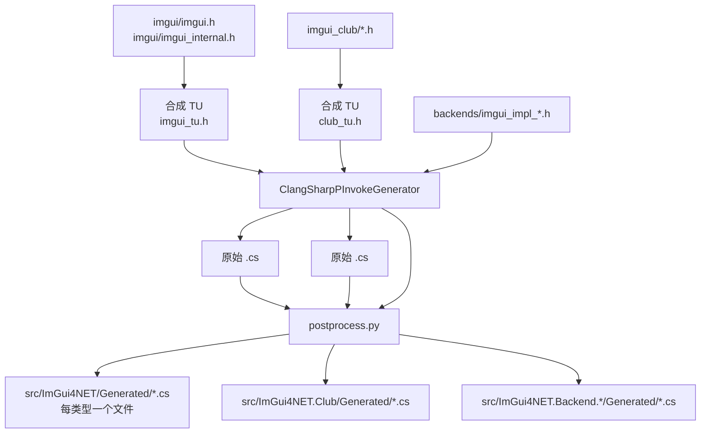

# 构建指南

[English](build.md) | **简体中文**

从源码构建 ImGui4NET 的完整流程。两个阶段互相独立：**生成绑定**（跑 ClangSharp）和**编译原生库**（跑 C++ 编译器）。

---

## 快速开始

```bash
# 1. 拉取子模块（imgui + imgui_club）
git submodule update --init --recursive

# 2. 还原 dotnet 工具（ClangSharpPInvokeGenerator）
dotnet tool restore

# 3. 下载 NuGet 形式的原生依赖（Allegro / freeglut）
./tools/fetch-deps.sh

# 4. 生成绑定 + 编译桌面原生库
./tools/generate.sh --native

# 5. 构建托管程序集
dotnet build ImGui4NET.slnx
```

只想要 NuGet 包：

```bash
dotnet pack ImGui4NET.slnx -c Release -o ./artifacts
```

> 首次运行 `generate.sh` 前必须先执行 `dotnet tool restore`。它会读取
> `dotnet-tools.json`，按锁定版本安装 `ClangSharpPInvokeGenerator`，保证不同机器上生成结果一致。

---

## 前置要求

| 工具 | 用途 | 版本 |
|---|---|---|
| .NET SDK | 编译托管代码、跑 ClangSharp | 10.0+ |
| bash | 执行 `tools/*.sh` | 4.0+ |
| python3 | 后处理生成结果 | 3.9+ |
| C++17 编译器 | 编译原生库 | g++ / clang++ / MSVC 的 clang |
| git | 子模块 | 任意 |

`tools/generate.sh` 会自己探测 `g++` → `clang++` → `c++`，也可以用 `CXX` 环境变量指定。

### 平台差异

| 平台 | 编译器 | 备注 |
|---|---|---|
| Windows | MSYS2 MinGW64 g++ | 路径通常为 `D:/Softwares/msys2/mingw64` |
| Linux | 系统 g++ | 需要 `build-essential libgl1-mesa-dev libglfw3-dev libsdl2-dev libvulkan-dev freeglut3-dev liballegro5-dev` |
| Android | NDK 里的 clang | 见下方专门章节 |

ClangSharp 需要一个 clang resource 目录。脚本会从 `MINGW_ROOT/lib/clang/*`、`/usr/lib/clang`、`/usr/lib/llvm-*/lib/clang` 中自动寻找，也可以显式指定：

```bash
export CLANG_RESOURCE=/path/to/clang/22
```

---

## `generate.sh` 用法

```bash
./tools/generate.sh                    # 只生成绑定
./tools/generate.sh --native           # 生成 + 编译桌面原生库
./tools/generate.sh --android          # 生成 + 编译 Android arm64 原生库
./tools/generate.sh --all              # 生成 + 桌面 + Android
./tools/generate.sh --native --no-generate   # 只编译原生库，保留现有绑定
./tools/generate.sh --help
```

### `--no-generate` 什么时候必须用

绑定是用 **Windows 三元组**（`x86_64-w64-windows-gnu`）生成的，所以 `DllImport` 里的名字是 **LLP64 mangling**：

```
_ZN5ImGui8MemAllocEy        ← y = unsigned long long（Windows 的 size_t）
```

如果在 Linux 上跑完整的 `generate.sh`，会用 `x86_64-unknown-linux-gnu` 重新生成，符号变成 LP64 拼写（`m`），**Windows 包立刻失效**。

所以跨平台时：

```bash
# 生成永远在 Windows 上做一次，提交结果
./tools/generate.sh

# Linux / Android 上只编译原生库
./tools/generate.sh --native --no-generate
./tools/generate.sh --android --no-generate
```

LP64 平台的符号差异由 `tools/lp64-aliases.py` 在链接期用 `--defsym` 补上，详见 [符号别名](#符号别名)。

### 环境变量

| 变量 | 默认值 | 说明 |
|---|---|---|
| `CXX` | 自动探测 | C++ 编译器 |
| `PYTHON` | `python3` | 后处理脚本解释器 |
| `MINGW_ROOT` | — | 帮助定位 clang resource 目录 |
| `CLANG_RESOURCE` | 自动探测 | clang 资源目录 |
| `ANDROID_NDK` | 自动探测 | NDK 根目录 |
| `ANDROID_API` | `24` | Android API 级别 |
| `TOOLCHAIN_PREFIX` | 由 `CXX` 推导 | 用于找 SDL2 等嵌套头文件 |

---

## 生成管线做了什么



### 为什么用合成 TU

直接生成 `imgui.cpp` 会漏掉所有**带函数体**的函数（`--generate funcs-with-body=false`），而只生成 `imgui.h` 又拿不到 `ImGuiContext`、`ImGuiWindow` 这些 internal 结构体的完整定义。

合成一个同时 include 两者的 `.h` 是唯一能一次拿全的方式：

```c
// imgui_tu.h
#include "imgui.h"
#include "imgui_internal.h"
```

### `-t` 与 `-f` 的区别

| 参数 | 含义 |
|---|---|
| `-f` | 解析入口（translation unit） |
| `-t` | 允许**输出**的头文件 |

这决定了 club 包为什么干净：

```bash
# imgui.h 只作为依赖解析，不放 -t
-t "$CLUB_TU" \
-t "imgui_club/imgui_memory_editor/imgui_memory_editor.h" \
...
```

如果把 `imgui.h` 也放进 `-t`，整个 imgui 的类型会被重复生成到 club 包里，和主库冲突。

### postprocess.py 的主要修正

ClangSharp 输出的是「C++ 思维的 C#」，必须改写才能编译：

| 处理 | 输入 | 输出 |
|---|---|---|
| 模板展开 | `ImVector<T>` / `ImBitArray` / `ImSpan` / `ImPool` / `ImChunkStream` / `ImStableVector` / `ImSmallStack` | 等价定长字段 |
| 去尾下划线 | `ImDrawFlags_` | `ImDrawFlags` |
| 字符串参数 | `sbyte* label` | `string label`（`LPUTF8Str`） |
| 字符串默认值 | `= "%.3f"u8` | `= null` |
| bool 默认值 | `byte x = false` | `byte x = 0` |
| 负数掩码 | `~0x7FFFFFF0` | `-2147483633` |
| 文件指针 | `_iobuf*` | `void*` |
| 结构体 unsafe | `partial struct` | `unsafe partial struct` |
| 构造函数 | `Foo(Foo* pThis)` | `Foo_Ctor(...)` |
| 类型前缀 | `ImGui_ImplDX11_RenderState` | `RenderState` |
| 方法前缀 | `ImGui_ImplOpenGL3_Init` | `Init` |
| 拆分 | 单文件 | 一类型一文件 |

> 去尾下划线时必须**先保护 `EntryPoint = "..."` 字符串**。mangled 符号本身可能以 `_` 结尾（`_Z10ImFileOpenPKcS0_`），误改会得到运行时 `EntryPointNotFoundException`。

---

## 原生库构建

### 桌面

```bash
./tools/generate.sh --native
```

产物位置：

```
src/ImGui4NET/runtimes/<rid>/native/imgui.dll | libimgui.so
src/ImGui4NET.Backend.*/runtimes/<rid>/native/imgui_backend_*.dll | lib*.so
src/ImGui4NET.Club/runtimes/<rid>/native/imgui_club.*
```

链接库按平台区分：

| 后端 | Windows | Linux |
|---|---|---|
| OpenGL2/3 | `-lopengl32` | `-lGL` |
| Glfw | `-lglfw3 -lopengl32 -lgdi32` | `-lglfw -lGL` |
| Glut | `-lopengl32 -lfreeglut` | `-lGL -lglut` |
| Sdl2 | `-lSDL2` | `-lSDL2` |
| Sdl3 / SdlGpu3 | `-lSDL3` | `-lSDL3` |
| Vulkan | `-lvulkan-1` | `-lvulkan` |
| DirectX9/11/12 | `-ld3d9` / `-ld3d11 -ldxgi` / `-ld3d12 -ldxgi` + `-ld3dcompiler` | — |
| Win32 | `-ldwmapi -lgdi32 -limm32 -lole32` | — |

### Android

```bash
export ANDROID_NDK=/d/AndroidSDK/android-ndk-r27c
./tools/generate.sh --android
```

脚本会自动定位 `aarch64-linux-android${ANDROID_API}-clang++`，并优先使用无 `.cmd` 后缀的版本（MSYS2 里两者都存在，无后缀的可被 bash 直接执行）。

**API 级别必须是 24+**，因为 `libvulkan.so` 从 24 才有。低于这个值 Vulkan 后端会链接失败。

Android 上可用的后端：

| 后端 | 可用 | 原因 |
|---|:---:|---|
| OpenGL3 | ✅ | 链接 `-lGLESv2 -lEGL` |
| Vulkan | ✅ | `-lvulkan` |
| Null | ✅ | 无依赖 |
| Android | ✅ | `-landroid -llog` |
| OpenGL2 | ❌ | 固定管线要 `GL/gl.h`，NDK 只有 GLES |
| Glfw / Sdl2 / Sdl3 / Glut / Allegro5 | ❌ | NDK 无对应头文件 |

### imgui_club 的特殊处理

club 扩展的方法全部**定义在类体内**：

```cpp
struct MemoryEditor {
    void DrawWindow(const char* title, void* mem_data, ...) { ... }  // 类内定义
};
```

这带来两个问题：

1. **ClangSharp 不生成 extern** —— `funcs-with-body=false` 会跳过带 body 的函数
2. **编译器不产生符号** —— inline 函数只在被调用的 TU 里实体化

解决办法分两层：

**生成期**：只拿结构体布局（`Generated/MemoryEditor.cs` 等），extern 由手写的 `ClubNative.cs` 提供。

**构建期**：`tools/club-instantiate.cpp` 实际构造并调用每个方法，配合编译器开关：

| 编译器 | 开关 | 说明 |
|---|---|---|
| GCC | `-fkeep-inline-functions` | 让内联定义被发出 |
| Clang | `-femit-all-decls` + `-O0` | **`-fkeep-inline-functions` 不被支持** |

Clang 上 `-O0` 是必须的：`-O2` 下它会把这些调用内联掉，构造函数就不会生成。

另外 Android 需要 `-fvisibility=default -Wl,--export-dynamic`，否则符号只在符号表里而不在动态表里，CLR 找不到。

---

## 符号别名

绑定是 LLP64 生成的，LP64 平台上这些差异需要修正：

| 类型 | Windows (LLP64) | x86_64 Linux | aarch64 Android |
|---|---|---|---|
| `size_t` | `y` | `m` | `m` |
| `FILE` | `_iobuf` | `_IO_FILE` | `__sFILE` |
| `va_list` | `Pc` / `S_` | `P13__va_list_tag` | `St9__va_list` |

`tools/lp64-aliases.py` 会比对「绑定期望的 EntryPoint」和「库实际导出的符号」，输出链接器参数：

```bash
-Wl,--defsym=_ZN5ImGui8MemAllocEy=_ZN5ImGui8MemAllocEm
```

这样**一份绑定同时服务三个平台**，不需要维护两套。

脚本对 core 和 club 都适用，且会**迭代到收敛**（每轮重新链接可能暴露更多可映射符号）：

```bash
for attempt in 1 2 3 4; do
    链接 → 重新计算别名 → 若数量不变则退出
done
```

---

## 产物结构

```
build/                          # 不提交，.gitignore 已排除
  implib/<rid>/libimgui.dll.a   # MinGW 链接期用，不进包
  logs/<name>.log               # 编译日志，失败时查看

src/ImGui4NET/
  Generated/                    # 212 个文件，一类型一文件
  runtimes/<rid>/native/        # 原生库
  ImVector.cs                   # 手写：C++ 模板无法生成
  NativeTypeNameAttribute.cs    # 手写：属性在包间共享需 public

src/ImGui4NET.Club/
  Generated/                    # 自动生成的结构体布局
  ClubNative.cs                 # 手写：inline 方法的 extern

src/ImGui4NET.Backend.*/
  Generated/                    # 每后端几个文件
  runtimes/<rid>/native/        # 该后端的原生库
```

---

## 常见问题

### `error: no clang resource directory found`

ClangSharp 需要 clang 的内置头文件。指定路径：

```bash
export CLANG_RESOURCE=D:/Softwares/msys2/mingw64/lib/clang/22
```

### Linux 上 `generate.sh` 报 `$'\r': command not found`

脚本是 CRLF 行尾。仓库有 `.gitattributes` 强制 `*.sh eol=lf`，若仍出现：

```bash
sed -i 's/\r$//' tools/*.sh
```

### `EntryPointNotFoundException` 在 Linux/Android 上

说明别名没生效。检查：

```bash
nm -D --defined-only src/ImGui4NET/runtimes/linux-x64/native/libimgui.so | grep _ZN5ImGui8MemAllocEy
```

应该同时看到 `...Ey` 和 `...Em` 两个符号。

### `rdynamic` 相关警告

Linux/Android 必须用 `-Wl,--export-dynamic`（脚本已带），否则动态符号表不完整。

### Android 上 `undefined symbol: ImGuiClub_ForceInstantiation`

`tools/club-instantiate.cpp` 没被编译进去。确认 `club_src` 数组包含它。

### `error: dotnet tool 'ClangSharpPInvokeGenerator' not found`

在仓库根目录执行 `dotnet tool restore`。

---

## 验证构建结果

```bash
# 托管层（同时构建 net8.0 与 net10.0）
dotnet build ImGui4NET.slnx

# 运行时冒烟测试
dotnet run --project samples/ImGui4NET.Sample.OpenGL3
```

该示例同时调用 `imgui_club` 的 Memory Editor，因此一次运行即可验证
`ImGui4NET.Club`（结构体布局、手写的 `MemoryEditor_Ctor` 与
`MemoryEditor_DrawWindow` 入口点）。

快速检查核心库导出的符号数量：

```bash
# Windows
objdump -p src/ImGui4NET/runtimes/win-x64/native/imgui.dll | grep -c '_Z'
# Linux / Android
nm -D --defined-only src/ImGui4NET/runtimes/linux-x64/native/libimgui.so | grep -c '_Z'
```

正常值：core 约 1200+，club 约 24（不含 inline 展开的额外符号）。

---

## 发布到 NuGet

发布由 CI（`.github/workflows/publish.yml`）在 `v*` 标签上执行，使用
[NuGet Trusted Publishing](https://learn.microsoft.com/nuget/nuget-org/trusted-publishing)：
工作流用 GitHub OIDC 令牌换取临时 API key，仓库里不保存长期密钥。

nuget.org 上的一次性配置：

1. Account → **Trusted Publishing** → 新增策略。
2. Repository Owner 填 `StArraySharp`，Repository 填 `ImGui4NET`，Workflow File 填
   `publish.yml`，Environment 填 `release`。
3. 在仓库添加 secret `NUGET_USER`，值为 nuget.org 的**用户名**（不是邮箱）。
4. 申请 `ImGui4NET` 前缀保留，防止他人发布 `ImGui4NET.*` 下的包。

发布一个版本：

```bash
# 1. 仅绑定变更时改 src/Directory.Build.props 的 LibraryRevision；
#    升级 Dear ImGui 时改 ImGuiVersion。
# 2. 更新 docs/CHANGELOG.md。
# 3. 打标签并推送，工作流会自动打包发布。
git commit -am "release: 1.93.0.2"
git tag v1.93.0.2
git push origin main --tags
```

标签与包版本不一致时工作流会拒绝发布。

本地预演：

```bash
dotnet pack ImGui4NET.slnx -c Release -o ./artifacts
# 推送前先检查包内容
unzip -l artifacts/ImGui4NET.1.93.0.1.nupkg
```