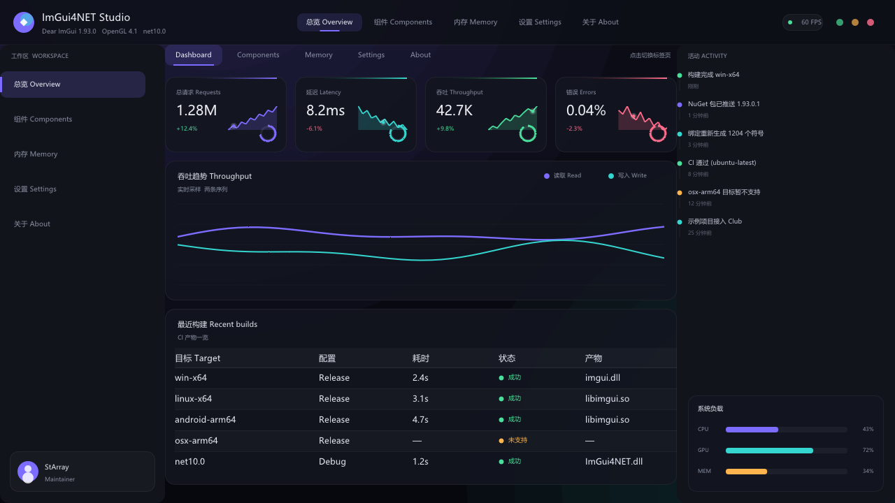
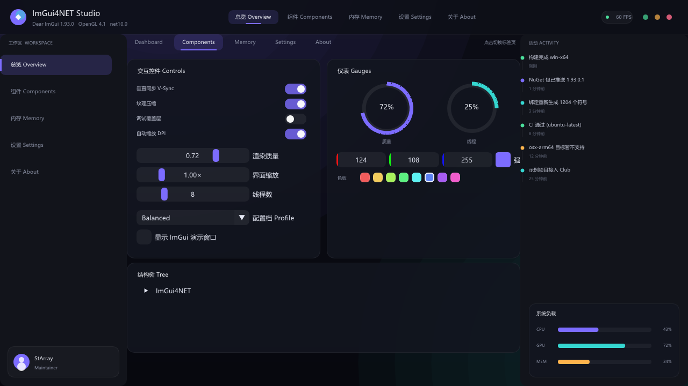
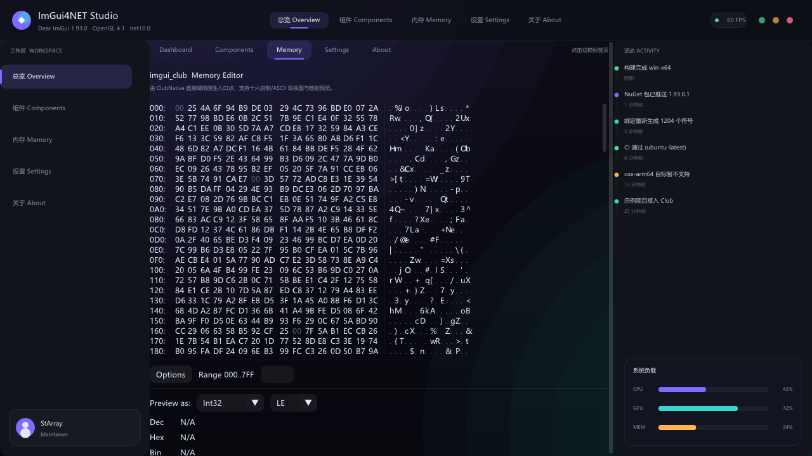

# ImGui4NET.Sample.OpenGL3

A complete Dear ImGui application built directly on the raw ImGui4NET bindings:
OpenTK supplies the window and the OpenGL 4.1 context, and every pixel of the UI
is drawn through `ImDrawList`.



## What it demonstrates

- **Bare-metal bindings** — `ImGui.CreateContext`, `ImGuiIO`, `ImGui.NewFrame`
  and `ImGui_ImplOpenGL3.*` are called exactly as the C++ API defines them. There
  is no wrapper layer.
- **Custom-drawn chrome** — the top bar, left rail, stat cards, sparklines,
  progress rings and the two-series chart are all `ImDrawList` primitives, so the
  layout does not depend on the stock widget metrics.
- **Microsoft YaHei** — `ShowcaseUi.LoadFonts` loads `msyh.ttc` from the Windows
  font directory with the Simplified Chinese glyph range, falling back to other
  CJK fonts and finally to the embedded default. All text sizes are baked from
  that single font through the dynamic atlas added in Dear ImGui 1.92.
- **imgui_club** — the Memory tab embeds `MemoryEditor` from `ImGui4NET.Club`.
- **Screenshot capture** — `Screenshot.Capture` reads the back buffer with
  `glReadPixels` and writes a PNG, which is how the images below were produced.

## Requirements

- .NET 10 SDK
- A GPU/driver with OpenGL 4.1
- Windows for the Microsoft YaHei font path; other platforms fall back
  automatically

## Running

```bash
dotnet run --project samples/ImGui4NET.Sample.OpenGL3
```

Press `Esc` to quit and `F12` to save a screenshot next to the working
directory.

### Headless screenshot

`--screenshot` renders a few frames, writes a PNG and exits, which is useful for
inspecting the UI from a terminal or in CI:

```bash
dotnet run --project samples/ImGui4NET.Sample.OpenGL3 -- \
  --screenshot artifacts/dashboard.png --tab 0
```

`--tab` selects the initial page: `0` Dashboard, `1` Components, `2` Memory,
`3` Settings, `4` About.

## Pages

### Dashboard

Four stat cards with animated sparklines and progress rings, a live two-series
throughput chart, and a table of recent CI builds.


### Components

Custom toggle switches, sliders, a profile combo, circular gauges, an accent
colour picker with a clickable palette, and a tree view. Each card is a child
window so the stock widgets flow normally inside it.



### Memory

The `imgui_club` Memory Editor, driven through the hand-written
`ClubNative.MemoryEditor_DrawContents` entry point.



## Project layout

| File | Purpose |
|---|---|
| `Program.cs` | OpenTK host: context creation, per-frame input feed, render loop |
| `ShowcaseUi.cs` | The whole dashboard: theme, fonts, layout, custom widgets |
| `Screenshot.cs` | `glReadPixels` back-buffer capture to PNG |

## A note on by-reference parameters

Dear ImGui declares many parameters as references with a default, for example:

```cpp
void SetNextWindowPos(const ImVec2& pos, ImGuiCond cond = 0,
                      const ImVec2& pivot = ImVec2(0, 0));
```

The C++ default constructs a temporary, so `pivot` is never null. The generated
binding exposes it as `ImVec2* pivot`, and passing `null` makes the native code
dereference a null pointer. The generator therefore drops the default for
by-reference parameters, forcing callers to pass an explicit pointer:

```csharp
var pos = new ImVec2 { x = 0, y = 0 };
var pivot = new ImVec2 { x = 0, y = 0 };
ImGui.SetNextWindowPos(&pos, (int)ImGuiCond.ImGuiCond_Always, &pivot);
```

Parameters that the native side genuinely null-checks (`IsMousePosValid`'s
`mouse_pos`, `DockSpace`'s `window_class`, `RenderTextClipped`'s `clip_rect`)
keep their `= null` default.
