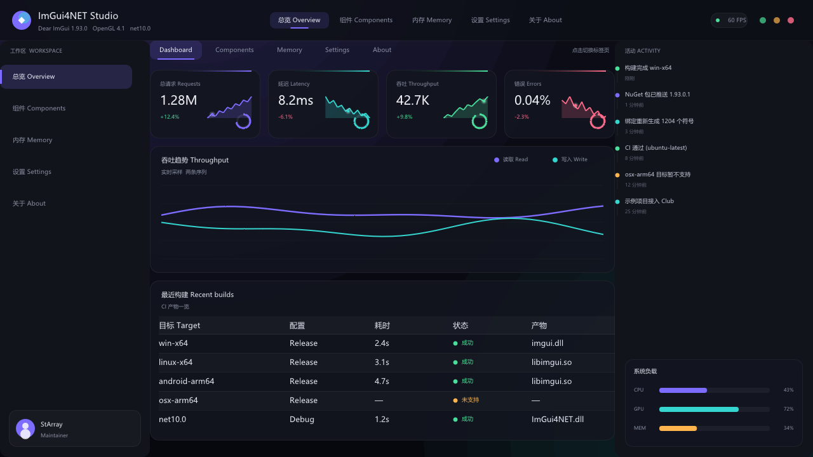
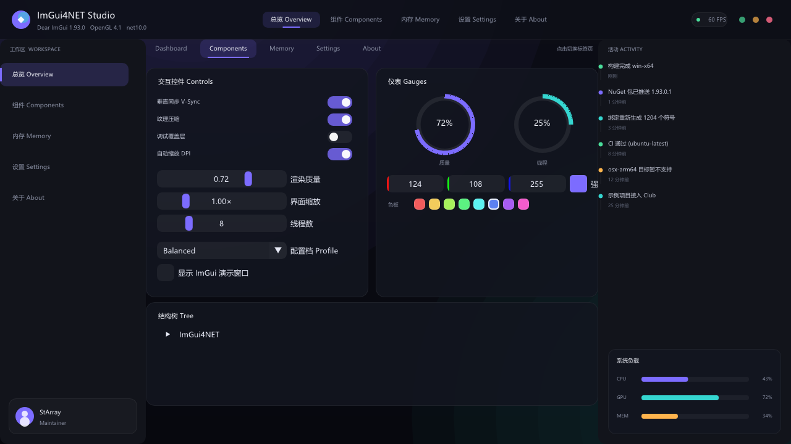
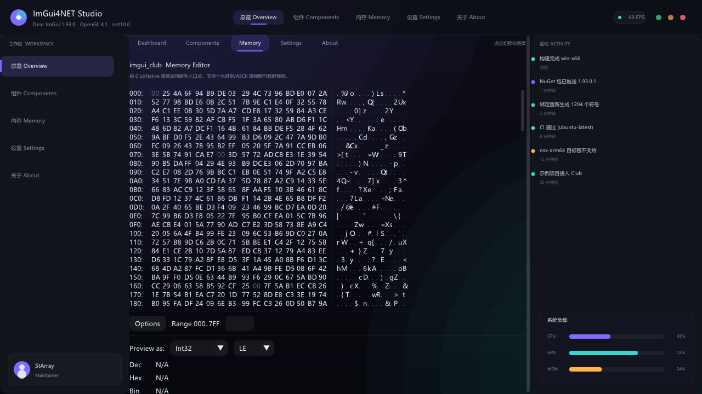

# ImGui4NET.Sample.OpenGL3

[English](README.md) | **简体中文**

一个完整的 Dear ImGui 应用，直接构建在 ImGui4NET 的原始绑定之上：OpenTK 提供
窗口与 OpenGL 4.1 上下文，界面上的每一个像素都通过 `ImDrawList` 绘制。



## 这个示例演示了什么

- **原样绑定** —— `ImGui.CreateContext`、`ImGuiIO`、`ImGui.NewFrame` 与
  `ImGui_ImplOpenGL3.*` 全部按 C++ API 的定义直接调用，中间没有包装层。
- **全自绘界面** —— 顶栏、左侧导航、统计卡片、迷你折线、环形进度与双序列图表
  都是 `ImDrawList` 图元，布局不依赖默认控件的尺寸度量。
- **微软雅黑** —— `ShowcaseUi.LoadFonts` 从系统字体目录加载 `msyh.ttc` 并带上
  简体中文字形范围，找不到时依次回退到其他中文字体，最后回退到内置字体。所有
  字号都由这一个字体经 Dear ImGui 1.92 起的动态图集烘焙而成。
- **imgui_club** —— 内存页嵌入了 `ImGui4NET.Club` 提供的 `MemoryEditor`。
- **截图** —— `Screenshot.Capture` 通过 `glReadPixels` 读取后备缓冲并写成 PNG，
  本文档中的图片就是这样生成的。

## 环境要求

- .NET 10 SDK
- 支持 OpenGL 4.1 的显卡与驱动
- 微软雅黑字体路径仅限 Windows；其他平台会自动回退

## 运行

```bash
dotnet run --project samples/ImGui4NET.Sample.OpenGL3
```

按 `Esc` 退出，按 `F12` 在工作目录下保存一张截图。

## 页面

### 总览 Dashboard

四张统计卡片（含动画迷你折线与环形进度）、一张实时的双序列吞吐图表，以及一份
最近的 CI 构建记录表。


### 组件 Components

自绘开关、滑块、配置档下拉框、环形仪表、带可点击色板的强调色选择器，以及树形
视图。每张卡片都是一个子窗口，因此内置控件在其中按正常流式布局排列。



### 内存 Memory

`imgui_club` 的 Memory Editor，通过其纯 C# 移植
（`MemoryEditor.DrawContents`）驱动。



## 项目结构

| 文件 | 作用 |
|---|---|
| `Program.cs` | OpenTK 宿主：创建上下文、逐帧送入输入、渲染循环 |
| `ShowcaseUi.cs` | 整个面板：主题、字体、布局与自绘控件 |
| `Screenshot.cs` | 通过 `glReadPixels` 抓取后备缓冲并保存为 PNG |